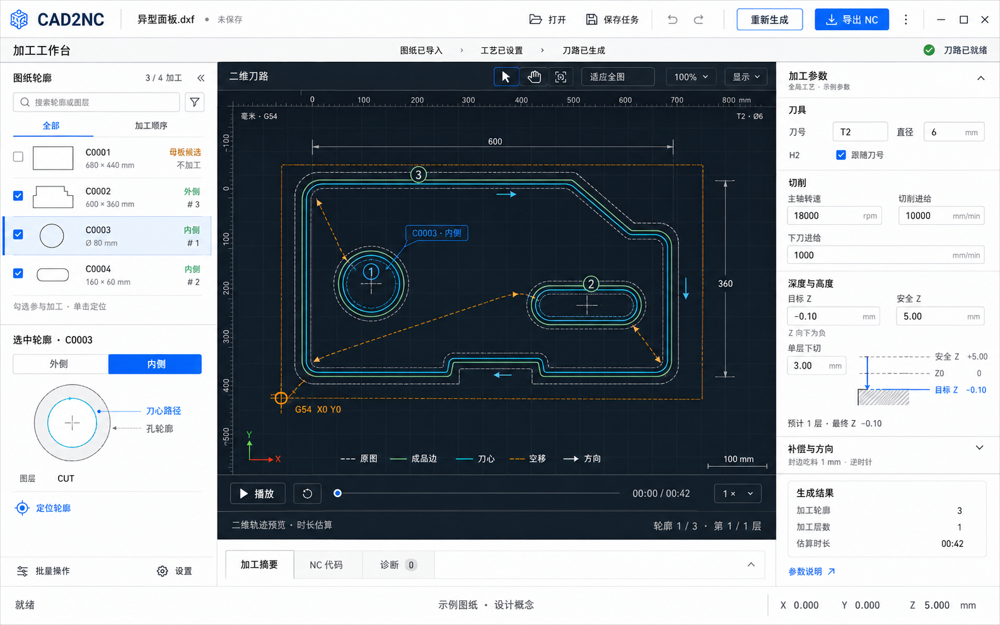

# CAD2NC 工作台 UI 重设计提案

日期：2026-09-05。范围：界面分析与概念设计，未修改应用实现。

分析依据为项目内当前浅色、深色、窄屏工作台截图与 WinUI 源码，并非本次运行中的窗口实测。效果图使用示例图形和示例数值，表达布局与视觉层级，不是实际计算输出。

## 设计判断

保留专业工作台的三栏结构，以图形预览作为主视觉。当前主要问题是顶部三层横栏、参数区长表单、重复的容器边框与全宽结果抽屉共同挤压工作区。已有的列表与画布联动、可调整侧栏、窄屏视图切换、错误定位、结果失效保护和 NC 只读模式都值得保留。

## 推荐布局

- 顶部：合并品牌、任务／源图纸、未保存状态及主要操作；按钮位置保持稳定，生成／导出按状态切换强调色。
- 轻量状态行：显示图纸、工艺、刀路状态；作为信息提示，不增加逐步确认流程。
- 左侧：约 240 DIP 的轮廓列表，以复选框表达参与加工，以行底色表达当前选中；增加形状缩略图与简短加工侧标识。
- 中央：尽量占可用宽度的 60% 以上，保留深色二维画布、坐标、原点、方向、顺序及播放控制；显示图例就近开关，减少打开菜单查找的次数。
- 右侧：约 300–340 DIP 的工艺面板，按刀具、切削、深度与分层组织。短数值适度双列，单位放在输入框末尾，复杂字段保留足够宽度。
- 底部：默认只留加工摘要／NC 代码／诊断标签条；常规展开优先占中央区域，并提供大视图查看源码或长诊断。
- 原有窄屏能力保留：缩小窗口时逐步收起侧栏，继续使用明确的预览／轮廓／参数／结果切换。

## 优先改进项

| 优先级 | 当前观察 | 改进 |
| --- | --- | --- |
| P0 | 旧结果的导出与播放已被禁用，但画布旧刀路仍按正常样式绘制 | 淡化失效刀路，并显示“上次结果 · 待更新”；可附变更原因 |
| P1 | 标题、命令、状态占据三行，工作区上下空间紧张 | 合并顶部信息，保留稳定的操作位置与简短状态 |
| P1 | 常用参数为连续六个纵向输入项，刀径和刀号分组分离 | 按工艺决策重新分组，适度双列，相关组内显示深度与层数摘要 |
| P1 | 展开结果会同时压缩左右面板和画布 | 将常规结果抽屉限制在中央列，可另行展开大视图 |
| P2 | 轮廓编号难以直接对应形状，选中与参与加工的数量反馈分散 | 形状缩略图、明确的选中数与加工数、选中后出现批量操作 |
| P2 | 内外侧与补偿关系主要依赖文字和说明页 | 加入内外侧微型示意和局部刀具侧预览，保留人工指定加工侧 |

## 关键交互

1. 单击轮廓用于选中与定位；只有复选框改变是否加工。批量操作明确写出作用集合与数量。
2. 参数修改后保留旧结果用于比较，但在画布中明确表示失效。更新按钮在原位置突出；导出继续按现有规则禁用。
3. 参数错误继续使用现有自动展开与定位，同时在对应字段附近呈现原因。
4. 生成成功时默认保持大画布；需要处理的诊断就近提示并可定位关联轮廓。
5. 加工侧用“外侧／内侧”简短标识，在选中详情里提供“保留哪侧、刀具走哪侧”的图示。
6. 外部 NC 使用阅读布局：画布与源码可并排查看，右侧程序参数标明只读；不展示可编辑加工参数。无法预览的程序优先展示源码与解析提示。

## 视觉规则

浅灰外壳、白色参数面板、深色画布；减少嵌套卡片，使用细分隔线建立层级。交互控件使用蓝色强调；原图、成品边、刀心、空移除颜色外继续用线型、标签和箭头区分。数字与坐标使用等宽字体，中文标签保持可读字号。

不把绿色“刀路已就绪”表达为实际机床加工已验证。原点含义继续遵循当前软件定义：所选刀心路线整体包围框左下角，而非自动认为是母板角点。

## 源码依据

- `src/Cad2Nc.App/MainWindow.xaml:15`：顶层行定义；`:250`：工作区及三栏宽度。
- `src/Cad2Nc.App/MainWindow.xaml:309`：不同集合的批量菜单；`:639`：常用加工参数；`:820`：结果标签区域。
- `src/Cad2Nc.App/MainWindow.xaml.cs:350`：CAD 与已生成刀路绘制逻辑。
- `src/Cad2Nc.Application/WorkbenchUiState.cs:77`：旧结果失效状态与当前下一步。
- `src/Cad2Nc.App/MainWindow.Workflow.cs:129`：外部 NC 模式及结果区状态。

## 概念图

使用内置 image_gen 生成；完整提示词见同目录 `ui-redesign-2026-09-05.prompt.txt`。图片中的示例轮廓、时长及几何偏移仅服务于设计表达，实际界面应显示程序计算值。
